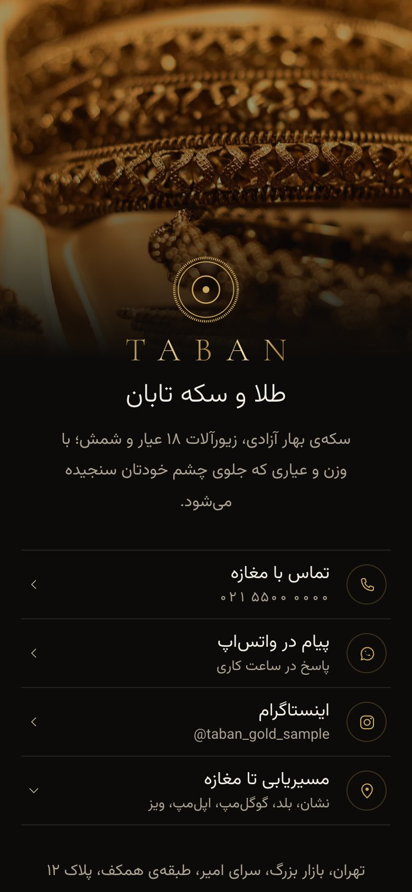
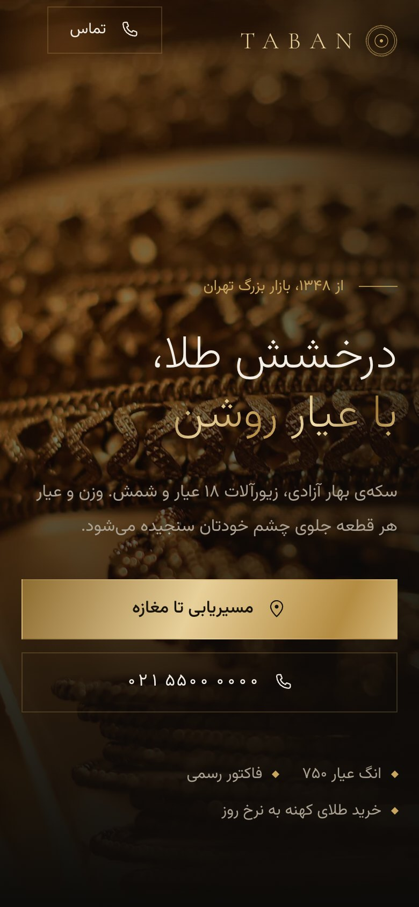
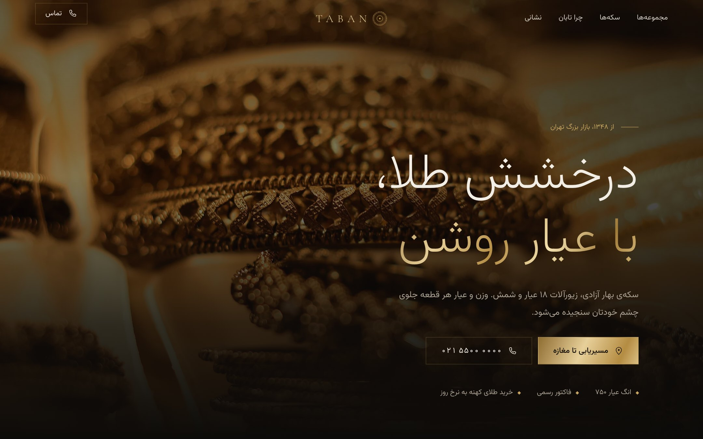

# طلا و سکه تابان — کارت تماس و سایت معرفی

نمونه‌ی طراحی برای طلافروشی: یک **کارت تماس (لینک‌بیو)** در ریشه‌ی دامنه و یک **سایت اصلی** در `/about/`.
طراحی لوکس و مدرن: مشکی گرم و طلایی شامپاینی، تایپوگرافی نازک فارسی (وزیرمتن) و نشان لاتین TABAN با فونت Cormorant، خطوط ظریف طلایی. فارسی و راست‌به‌چپ، با اولویت موبایل و آیفون. HTML و CSS ساده، بدون فریم‌ورک و بدون وابستگی به سرویس خارجی. اسکرول کاملاً طبیعی است؛ هیچ بخشی قفل یا سنجاق نمی‌شود و فقط سربرگ ثابت است.

> نام «تابان»، نشانی، شماره‌ها و مختصات نقشه **نمونه** هستند و پیش از انتشار باید با اطلاعات واقعی عوض شوند.

| کارت تماس (موبایل) | سایت اصلی (موبایل) | سایت اصلی (دسکتاپ) |
|---|---|---|
|  |  |  |

## چه چیزهایی دارد

**کارت تماس (`/`)**: عکس طلا در بالا (در دسکتاپ نیمه‌ی صفحه)، نشان، نام، معرفی کوتاه، تماس، واتس‌اپ، اینستاگرام، مسیریابی با انتخاب برنامه (نشان، بلد، گوگل‌مپ، اپل‌مپ، ویز)، نشانی، ساعت کار و دکمه‌ی «ورود به سایت اصلی». بدون جاوااسکریپت کار می‌کند.

**سایت اصلی (`/about/`)**:
- صفحه‌ی اول تمام‌صفحه با عکس النگوهای طلا و تیتر «درخشش طلا، با عیار روشن»
- نوار متحرک اجناس
- مجموعه‌ها: سکه‌ی بهار آزادی، زیورآلات ۱۸ عیار، سفارش ساخت
- سکه‌ها: جدول مشخصات واقعی (وزن، عیار، قطر) و سه سکه به اندازه‌ی واقعیِ نسبت به هم؛ با زدن روی سکه یا دکمه‌ها، مشخصات عوض می‌شود
- چرا تابان: وزن، عیار، فاکتور
- میراث: ۲۵۰۰ سال طلای ایرانی (قطعه‌های هخامنشی)
- نشانی، ساعت کار، تماس و مسیریابی
- پانویس با نشان TABAN

حرکت‌ها با GSAP و ظریف‌اند و برای کسانی که در تنظیمات گوشی «کاهش حرکت» را روشن کرده‌اند خاموش می‌شوند. همه‌ی محتوا بدون جاوااسکریپت هم دیده می‌شود.

## تغییر اطلاعات (برای صاحب مغازه)

همه‌چیز در دو فایل است: `site/index.html` (کارت) و `site/about/index.html` (سایت اصلی). با هر ویرایشگر متنی باز کنید و این‌ها را جست‌وجو و جایگزین کنید:

| چه چیزی | متن فعلی برای جست‌وجو |
|---|---|
| تلفن ثابت | `+982155000000` (در لینک) و `۰۲۱ ۵۵۰۰ ۰۰۰۰` (متن نمایشی) |
| واتس‌اپ | `wa.me/989120000000` (شماره با ۹۸ و بدون صفر) |
| اینستاگرام | `taban_gold_sample` |
| نشانی | `سرای امیر` |
| ساعت کار | `۱۰ تا ۱۹` و `۱۰ تا ۱۴` |
| مختصات نقشه | `35.6740` و `51.4217` (از گوگل‌مپ یا نشان: روی مغازه نگه دارید و عدد را کپی کنید) |
| نام مجموعه | `تابان` |

بعد از ذخیره، فایل را دوباره روی هاست آپلود کنید.

## انتشار روی هاست (راهنمای کوتاه)

1. **دامنه** (مثلاً `yourshop.ir`): دامنه‌ی `.ir` را با نام و شناسه‌ی **خود صاحب مغازه** در nic.ir یا از نمایندگی‌های رسمی ثبت کنید تا مالکیت همیشه با خودش باشد.
2. **هاست**: یک هاست اشتراکی ایرانی با cPanel یا DirectAdmin کافی است. کمترین پلن کافی است، چون کل سایت حدود ۲ مگابایت است. حساب هاست هم به نام خود صاحب مغازه باشد.
3. در پنل دامنه، **DNS** (نیم‌سرورها) را روی آدرس‌هایی که هاست می‌دهد بگذارید. اعمالش معمولاً چند ساعت طول می‌کشد.
4. **محتوای پوشه‌ی `site/`** (نه خود پوشه) را در `public_html` آپلود کنید. فایل `.htaccess` مخفی است؛ مطمئن شوید آپلود شده.
5. **HTTPS**: در پنل هاست، SSL رایگان (AutoSSL یا Let's Encrypt) را برای دامنه فعال کنید. بعد در `.htaccess` علامت `#` را از چهار خطِ زیر «HTTPS and no www» بردارید تا همه به `https://` بروند.
6. همه‌ی صفحه‌ها فایل واقعی‌اند (`/index.html` و `/about/index.html`)، پس **رفرش هیچ‌وقت خطای ۴۰۴ نمی‌دهد**. نشانی‌های اشتباه هم صفحه‌ی `404.html` را نشان می‌دهند.
7. فونت‌ها (وزیرمتن و Cormorant) و همه‌ی تصاویر روی خود هاست هستند؛ سایت به هیچ CDN یا سرویس خارجی وابسته نیست.

هزینه‌ی هاست و دامنه و تمدید سالانه‌ی آن‌ها جدا از طراحی است و به سرویس‌دهنده‌ای که انتخاب می‌کنید بستگی دارد.

## پیش‌نمایش روی کامپیوتر

```bash
python3 -m http.server 8765 --directory site
```

بعد `http://localhost:8765` را باز کنید.

## ساختار

```
site/                 همه‌ی آنچه روی هاست می‌رود
  index.html          کارت تماس
  about/index.html    سایت اصلی
  404.html  .htaccess  robots.txt
  assets/css/taban.css
  assets/js/site.js   مقایسه‌ی سکه‌ها و حرکت‌ها
  assets/js/vendor/   GSAP 3.15 (مجوز رایگان GSAP)
  assets/fonts/       وزیرمتن و Cormorant Garamond (OFL)
  assets/img/         تصاویر WebP
sources/              عکس‌های اصلی و credits.json (روی هاست نمی‌رود)
docs/screenshots/     تصاویر نمونه‌کار
```

## منبع عکس‌ها

- النگوهای طلا (صفحه‌ی اول، کارت، سفارش ساخت): A S M Jobaer، CC BY-SA 4.0
- ویترین طلا: dconvertini، CC BY-SA 2.0
- سکه‌های بهار آزادی: امین یاری، CC BY 4.0
- قطعه‌های طلای هخامنشی (ریتون، دریک، زیور شیرها، پلاک شیردال‌ها): موزه‌ی متروپولیتن، CC0
- سنگ محک: Mauro Cateb، CC BY-SA 3.0
- ترازوی طلا: نگارخانه‌ی ملی هنر آمریکا، CC0
- گنبد بازار تهران: Eliabbasi، CC BY-SA 4.0

عکس‌ها برش خورده‌اند و رنگ و روشنایی‌شان تنظیم شده است. نسخه‌های تغییریافته‌ی عکس‌های CC BY-SA با همان مجوز منتشر می‌شوند. لینک‌ها در پانویس سایت و `sources/credits.json` است. در نسخه‌ی نهایی برای مشتری، بهتر است عکس‌های خود مغازه جایگزین شوند.
